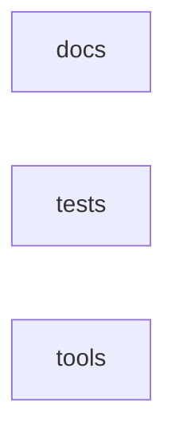

<!-- codemap: v0.5.0 -->
<!-- Generated by codemap — do not hand-edit. Edit annotations.yaml and regenerate. -->
# Code Map Guide

Directory rollups list paths without file counts. Adding ordinary files within an existing
directory does not change the map. Collection rows cover scripts, route/action trees, migrations and
docs audits/plans/specs/reports/worknotes recursively: new files or subfolders inside them need no map edit.
Browse the listed folder; deliberate directory notes preserve useful routing and constraints.
Outside collections, new or removed directories and structural files change the map; annotations always do.
Regenerate and run check for structural changes; never hand-edit generated maps or bump counts.

## docs

Roots: docs

## tests

Roots: tests

## tools

Roots: tools

- **tools/scripts/** (collection) — Operational scripts and helpers; browse the folder or search by task.

